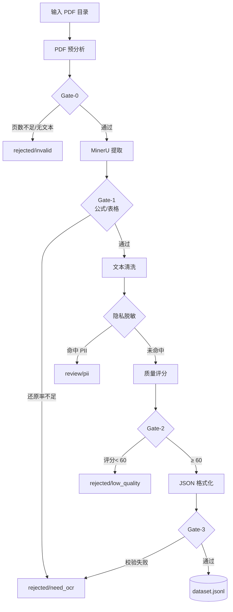

# AI-Ready 数据生产线

> 从「粗糙 PDF」到「可直接喂给大模型的训练数据」——
> 用**量化基线** + **质量闸门** + **自动分流**替代盲目生产。

[](https://www.python.org/)
[](LICENSE)

---

## 当前进度

| 模块 | 状态 |
|---|---|
| 第一阶段 · PDF 量化基线 | ✅ **已完成**（公式 63 个、跨页表格 4 处、CID 乱码 4,199 处）|
| 第二阶段 · 流水线设计 | ✅ **已完成**（四道质量闸门 + 五条分流路径 + 配置 + Prompt） |
| 质量判定器分流自测 | ✅ **已完成**（3 个样本全部正确判定） |
| 第一阶段 · MinerU 四组对比 | ⏳ **待补**（需用官方 Demo 跑，详见 `report/实验报告.md` §1.5） |

> **为什么用官方 Demo**：本机网络实测仅 18 kB/s，MinerU 依赖链
> （gradio 31MB + torch 1-2GB + 模型权重）需 4–8 小时。
> 实验设计不变，仍是严格的 2×2 因子对照。

---

## 这个项目在解决什么问题

很多人以为「PDF 转 Markdown」就是调个API 完事。真正做过的人会发现：

| 朴素做法的问题 | 实证后果 |
|---|---|
| 直接复制粘贴 PDF 文字 | 实验素材中**仅 26.24%** 的行不含乱码 |
| 公式被压平成`(cid:11)` | 数学语义**完全丢失** |
| 表格被压平成字符流 | 数值与列名**无法对应** |
| 页眉页脚页码残留 | 重复内容**浪费上下文窗口** |
| 100 份文档人工检查 | **不可行** |

本项目解决两件事：
1. **第一阶段**：用MinerU 把粗糙 PDF 变成结构化 Markdown，并用**量化指标**评估还原质量
2. **第二阶段**：设计带**质量闸门与自动分流**的流水线，能拒绝低质量文档

---

## 核心洞察：粗糙 PDF 不是「质量差的文本」

实验素材（《中国工业经济》2016 年论文）的文本层实测：

```
CID 乱码总数      : 4,199 处
平均每行          : 7.15 处
可直接使用的行: 154 / 587（26.24%）
```

真实提取样例：

| 提取到的「文本」 | 实际问题 |
|---|---|
| `Entry i;j;t =(cid:11)+ (cid:12) K Treat i K ;t` | 公式符号全丢 |
| `„(cid:129) (cid:136)"G ! (cid:246)ı !` | 回归表列标题不可读 |
| `!C%%2 -%C!,4 -%C!,4 !C%%2 -%C!,4` | 数值与标准误粘连 |

**这些不是「质量差」，而是语义已被破坏的噪声。**
大模型会把它们当正常语言模式学习，既浪费上下文又污染语义。

---

## 项目结构

```
├── src/
│   ├── pdf_profiler.py         # 提取前的量化体检（建立评估基线）
│   ├── extraction.py           # MinerU 封装，公式/表格开关可配置
│   ├── run_comparison.py       # 第一阶段对比实验（2×2 因子设计）
│   ├── quality_judge.py        # 质量闸门：规则层 + 模型层
│   └── selftest_quality_judge.py # 分流能力自测
├── config/
│   ├── pipeline.yaml           # DataFlow-Agent 流水线配置
│   ├── schema.json             # 输出 JSON Schema
│   └── prompts/quality_judge.txt # 质量评分 Prompt
├── docs/
│   ├── pipeline_design.md      # 第二阶段完整设计（含 Mermaid 流程图）
│   └── manual_check_template.md# 人工核查模板
├── report/实验报告.md           # 实验报告
├── data/raw/                    # 实验素材（不含 PDF，见下方版权声明）
├── results/                    # 量化结果
└── figures/                    # 图表
```

---

## 快速开始

```bash
pip install -r requirements.txt
# MinerU 体积较大（依赖 torch），单独安装
pip install -U "mineru[core]"

# 1. 提取前的量化体检（不需要 MinerU）
python src/pdf_profiler.py --pdf <你的PDF> --json results/profile.json

# 2. 质量判定器自测（不需要 MinerU）
python src/selftest_quality_judge.py

# 3. 第一阶段对比实验（需要 MinerU）
python src/run_comparison.py --pdf <你的PDF> --baseline results/profile.json
```

---

## 三层设计

### 第一层：量化基线（`pdf_profiler.py`）

在提取之前先「体检」，为后续评估建立客观基线。

**检测项**：

| 指标 | 说明 |
|---|---|
| 公式检出 | 行尾编号 + 行内`$...$` + `式(1)` 三种模式，兼容中英文论文 |
| 表格检出 | 线框检测 + 跨页表格识别 |
| 跨页表格 | 四种判据：表头重复、续表标记、**列数压窄**、多页延续 |
| 噪声 | 页眉、页脚、页码、DOI/ISSN 关键词 |
| 标题| 中英双语编号体系（一、/ （一） / 1. / 1.1）|
| **CID 乱码** | `(cid:NN)` 计数与占比 —— AI-Ready 的核心指标 |

**跨页表格检测的四种判据**（互相补充）：

```python
# 判据 1：表头文本在多页重复
# 判据 2：续表标记（"Table X (continued)" / "续表"）
# 判据 3：跨页压窄——续页列数少于首页（最可靠）
# 判据 4：多页延续——连续三页列数呈"宽→窄→窄"
```

实测在某《中国工业经济》论文上识别出 p6→p7→p8 的跨页回归表。

### 第二层：质量闸门（`quality_judge.py`）

**规则层 + 模型层双轨**，缺一不可。

| 层 | 负责 | 优势 |
|---|---|---|
| **规则层** | 乱码率、公式还原率、表格召回率、残留噪声 | 可复现、可审计、零成本 |
| **模型层** | 内容截断、章节断层、占位符残留 | 能理解语义 |

**实测的分流能力**：

| 样本 | 预期 | 实际 | 拒绝理由 | 质量分 |
|---|---|---|---|---|
|粗糙 PDF 文本层 | 拒绝 | ✓ 拒绝 | `cid_garbage_high(715.3%>40%)` | 75 |
| 结构化 Markdown | 通过 | ✓ 通过 | — | 96 |
| 占位符残留 | 拒绝 | ✓ 拒绝 | `formula_loss` / 信息量 0 分 | 52 |

**注意第一行**：模型层给了 75 分（看起来不低），但**规则层拦下了它**。
如果只依赖模型评分，715% 的乱码率可能因为「结构完整」而被误判为合格。
这正是双轨设计的价值。

### 第三层：流水线与分流（`config/pipeline.yaml`）

四个质量闸门 + 五条分流路径：



**核心原则：流水线必须能「拒绝」一份文档，而不是被迫接受。**

---

## 第一阶段实验设计

采用 **2×2 因子设计**，四组对照：

| 组 | 公式识别 | 表格识别 | 用途 |
|---|---|---|---|
| A | ✓ | ✓ | 全功能（基准） |
| B | ✗ | ✓ | 只关公式 |
| C | ✓ | ✗ | 只关表格 |
| D | ✗ | ✗ | 全关闭（对照） |

评价指标均以 `pdf_profiler` 的基线为分母：

- 公式还原率 = LaTeX 块数 / 基线公式数
- 表格召回率 = 提取表格数 / 基线表格数
- 标题还原率 = 输出标题数 / 基线标题数
- 有效字符占比 = 无乱码行占比
- 质量分 = 四维评分之和

---

## 项目特色

1. **量化而非感觉**：所有「还原得好不好」的判断都有客观指标，
   避免「看起来还行」的主观评估
2. **双轨判定**：规则层与模型层职责分离，实验证明单靠模型会误判
3. **优雅降级**：MinerU 未安装时脚本仍可运行并输出基线，不崩溃
4. **离线可测**：质量判定器有自测脚本，不依赖网络与模型 API
5. **中文适配**：公式编号、标题体系、跨页表格检测均针对中文论文做过验证

---

## 版权与合规声明

-实验素材为《中国工业经济》已发表论文的公开 PDF，
  仅用于方法演示与教学实验，**不随本仓库分发**
- 仓库中不包含任何原始 PDF 文件，请自行从原出处获取
- 本项目所有代码为原创实现，未复制任何来源的代码

## License

MIT
