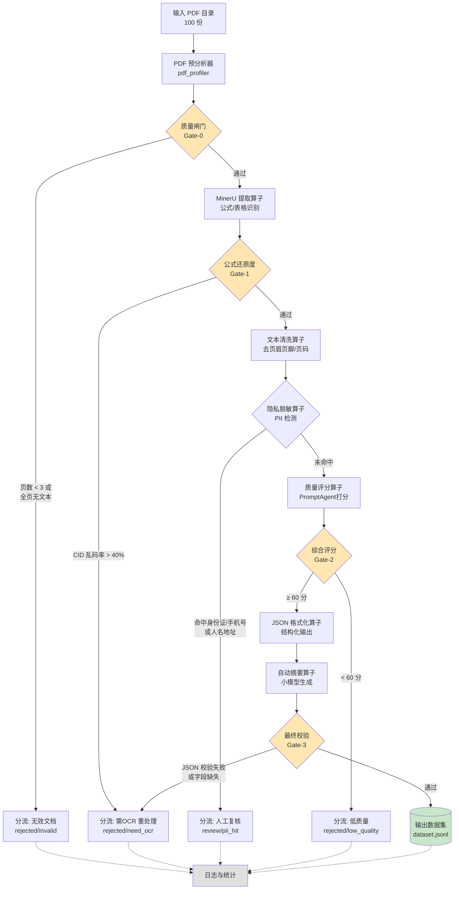

# DataFlow-Agent 流水线设计（第二阶段）

> 目标：把「PDF → AI 训练数据」做成**可规模化、能识别低质量数据并自动分流**的自动化流水线，而非盲目生产垃圾数据。

---

## 一、为什么线性流水线不够

朴素的流水线是：

```
PDF → 提取 → 清洗 → 格式化 → 输出
```

但真实场景有三个问题让它失效：

| 问题 | 后果 | 解决方案 |
|---|---|---|
| **单文档质量差异极大** | 扫描件、加密 PDF、纯图片 PDF 混入，产出大量空/乱码数据 | 引入**质量闸门**，低质数据自动分流 |
| **人工无法处理 100 份** | 逐份检查公式/表格是否正确不现实 | 用**规则 + 小模型评分**做自动判定 |
| **隐私与合规风险** | 学术论文、企业报告含未脱敏信息 | 插入**隐私脱敏算子**，正则 + NER 双重识别 |

**核心设计原则：流水线必须能「拒绝」一份文档，而不是被迫接受。**

---

## 二、整体工作流（Mermaid）



**四个质量闸门（Gate）的作用**：

| 闸门 | 位置 | 判定依据 | 分流去向 |
|---|---|---|---|
| Gate-0 | 提取前 | 页数、CID 乱码率、文本密度 | `rejected/invalid` |
| Gate-1 | 提取后 | 公式是否还原为 LaTeX、表格是否保留结构 | `rejected/need_ocr` |
| Gate-2 | 脱敏后 | 综合质量评分（0-100） | `rejected/low_quality` |
| Gate-3 | 序列化前 | JSON schema 校验 | `rejected/schema_error` |

---

## 三、判断逻辑：规则 vs 模型

作业要求说明「判断条件是什么（例如通过正则匹配乱码，还是调用一个小模型评分）」。本设计**两者并用，各司其职**：

### 3.1 规则层（快速、确定性、零成本）

负责**可量化**的判断，放在流水线前部：

```python
# 规则1：CID 乱码率（对应实验阶段一的核心指标）
cid_ratio = count_cid_garbage(text) / max(count_lines(text), 1)
if cid_ratio > 0.40:
    return "rejected/need_ocr", {"reason": "cid_ratio", "value": cid_ratio}

# 规则2：公式还原度——抽到的 LaTeX 块数 vs PDF 预分析检出的公式数
latex_blocks = count_latex_blocks(text)      # 形如 $$...$$ 或 $...$
expected    = profile.total_eq_numbers        # 来自 pdf_profiler
if expected > 0 and latex_blocks / expected < 0.6:
    return "rejected/formula_miss", {...}

# 规则3：表格结构——HTML/Markdown 表格数 vs 检出表格数
md_tables = count_md_tables(text)
if profile.total_tables > 0 and md_tables < profile.total_tables:
    return "rejected/table_lost", {...}

# 规则4：残留噪声——页码/页眉关键词
if count_page_number_noise(text) > threshold:
    触发重清洗
```

**规则的优势**：可复现、可审计、零成本，适合拦住「明显不合格」的部分。

### 3.2 模型层（PromptAgent，负责语义判断）

规则拦不住的是「**结构完整但内容空洞**」的文档——比如提取出的 Markdown 语法正确、公式齐全，但正文被截断、章节顺序错乱、或图表说明丢失。这类问题需要语义理解。

**Prompt 设计思路**（作业要求的「Prompt 设计」部分）：

```
角色设定：
你是一个数据集质量审核员。你的任务是判断给定的 Markdown 文档
是否适合作为高质量训练数据。你只输出 JSON，不做任何解释。

判断维度（每项 0-25 分）：
1. 完整性：文档是否有完整的开头、主体和结尾？是否被截断？
2. 结构连贯性：章节顺序是否合理？标题层级（H1/H2/H3）是否连续？
3. 实质信息量：正文是否有可供学习的实质内容，而非占位符、
   重复文本或「待补充」之类的空壳？
4. 可读性：是否存在大量乱码、粘连字符（如 (cid:NN)、
   不明符号、错误换行？

输出格式（严格 JSON，无多余文字）：
{
  "score": <0-100总分>,
  "dimension_scores": {
    "completeness": <0-25>,
    "coherence": <0-25>,
    "information_density": <0-25>,
    "readability": <0-25>
  },
  "verdict": "accept" | "reject",
  "reason": "<不超过50字的说明>"
}

待审文档：
{{markdown_content}}
```

**设计要点**：
- **角色 + 任务 + 格式约束**三段式，避免模型自由发挥
- **强制 JSON 输出**，便于程序解析，减少后处理成本
- **分数而非二元判断**——便于设置不同阈值（比如训练集要 80 分、验证集放宽到 60 分）
- **维度拆解**——便于定位问题类型，决定是重新提取还是直接丢弃

---

## 四、DataFlow-Agent 配置

### 4.1 算子清单

| 算子 | 类型 | 输入 | 输出 | 作用 |
|---|---|---|---|---|
| `PDFIngest` | Source | PDF 目录 | 文件列表 | 遍历目录 |
| `ProfileGate` | Judge | PDF | 通过/拒绝 + 原因 | Gate-0 预分析 |
| `MinerUExtract` | Operator | PDF | Markdown | 提取（可开关公式/表格识别）|
| `QualityJudge` | LLM | Markdown | 评分 JSON | 规则 + 模型双重判定 |
| `NoiseClean` | Operator | Markdown | Markdown | 去页眉/页脚/页码 |
| `PIIMask` | Operator | Markdown | Markdown | 隐私脱敏 |
| `Summarize` | LLM | Markdown | 摘要 | 自动摘要 |
| `JsonFormat` | Operator | dict | JSONL | 结构化输出 |
| `SchemaValidate` | Judge | JSON | 通过/拒绝 | Gate-3 校验 |

### 4.2 流水线配置

见 `config/pipeline.yaml`。核心是**条件分支**：

```yaml
pipeline:
  name: pdf-to-ai-ready
  version: "1.0"

stages:
  - id: ingest
    operator: PDFIngest
    config:
      input_dir: data/raw
      pattern: "*.pdf"

  - id: pre_gate
    operator: ProfileGate          # Gate-0
    config:
      min_pages: 3
      max_cid_ratio: 0.40
    on_reject: quarantine_invalid

  - id: extract
    operator: MinerUExtract
    config:
      formula_enable: true# ← 对比实验变量
      table_enable: true        # ← 对比实验变量
      backend: pipeline
    depends_on: pre_gate

  - id: post_gate
    operator: QualityJudge        # Gate-1 + Gate-2
    config:
      rules:
        min_latex_ratio: 0.6
        min_table_recall: 1.0
      llm_prompt: prompts/quality_judge.txt
      threshold: 60
    on_reject: quarantine_lowq

  - id: clean
    operator: NoiseClean
    config:
      drop_page_number: true
      drop_header_footer: true

  - id: mask
    operator: PIIMask
    config:
      entities: [ID_CARD, PHONE, NAME, ADDRESS, EMAIL]
      on_hit: review            # 命中不直接丢弃，转人工复核

  - id: summarize
    operator: Summarize
    config:
      max_tokens: 300

  - id: format
    operator: JsonFormat
    config:
      schema: config/schema.json

  - id: validate
    operator: SchemaValidate    # Gate-3
    config:
      strict: true
    on_reject: quarantine_schema

outputs:
  - id: dataset
    path: data/output/dataset.jsonl
  - id: quarantine
    paths:
      - data/output/quarantine/invalid
      - data/output/quarantine/lowq
      - data/output/quarantine/schema
      - data/output/review/pii
  - id: metrics
    path: results/pipeline_metrics.json
```

---

## 五、PromptAgent 的使用

DataFlow-Agent 的 PromptAgent 用于**自动生成或调优算子配置**。本设计中的两个用法：

### 用法1：生成分流规则

Prompt：
```
我有一条PDF → AI-Ready 数据的流水线，产出质量不稳定。
请为以下三个闸门各写一段 Python 判断逻辑：
1. 预提取闸门：判断 PDF 是否值得提取
2. 提取后闸门：判断 Markdown 是否合格（公式/表格/噪声）
3. 序列化闸门：判断 JSON 是否符合 schema

要求：只返回可运行的 Python 函数，函数签名统一为
check(x: dict) -> tuple[bool, str]（是否通过 + 拒绝原因）。
不要引入除 re/json/math 以外的第三方库。
```

### 用法2：生成 Prompt 模板

Prompt：
```
请为「训练数据质量评分」写一个 Prompt 模板，要求：
- 角色 + 任务 + 输出格式三段式
- 输出严格 JSON
- 含 4 个评分维度（完整性/连贯性/信息量/可读性）
- 明确指出常见问题（如 cid 乱码、章节断层、占位符残留）
```

**实测建议**：PromptAgent 生成的代码需人工 review，尤其是**阈值**（如 `max_cid_ratio: 0.40`）不能盲目采纳，应基于第一阶段的实测分布来确定。

---

## 六、目录结构

```
config/
├── pipeline.yaml           # 流水线配置
├── schema.json             # 输出 JSON schema
└── prompts/
    └── quality_judge.txt   # 质量评分 Prompt
src/
├── pdf_profiler.py         # Gate-0 的实现
├── extraction.py           # MinerU 调用封装（支持功能开关）
├── quality_judge.py        # Gate-1/2 的实现
└── run_pipeline.py         # 主控：批量处理 + 分流
results/
├── profile_primary.json    # 预分析基线
├── pipeline_metrics.json   # 流水线运行指标
└── comparison_table.md     # 公式/表格识别开/关对比
```

---

## 七、预期产出指标

| 指标 | 含义 |
|---|---|
| `total_in` | 输入文档数（100）|
| `accepted` | 通过全部闸门、进入数据集的文档数 |
| `rejected_invalid` | Gate-0 拦下（无有效文本）|
| `rejected_need_ocr` | Gate-1 拦下（乱码率过高，需 OCR）|
| `rejected_lowq` | Gate-2 拦下（评分不足）|
| `rejected_schema` | Gate-3 拦下（JSON 校验失败）|
| `review_pii` | 命中隐私规则，转人工 |
| `accept_rate` | 接受率 = accepted / total_in |

**这组数字本身就是实验报告的核心结论**：一条能自动分流的流水线，输出质量远高于「全量接收 + 事后人工筛」。
